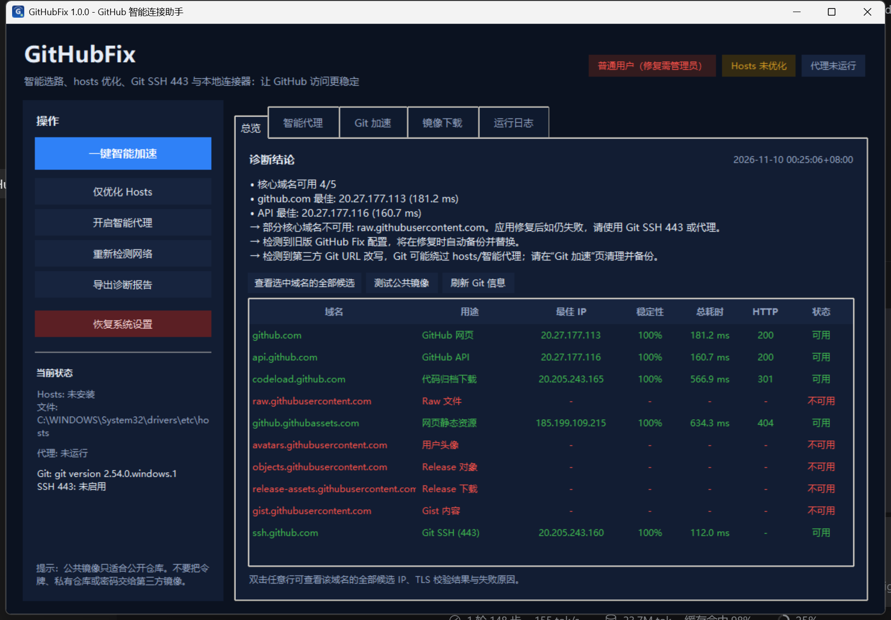

# GitHubFix

一个面向 Windows 的 GitHub 智能连接助手：自动测速 GitHub 域名、安全维护 hosts、按域名分流到本地智能连接器，并提供 Git SSH 443 与公共镜像测速。

## 为什么需要它

国内访问 GitHub 不稳定通常不是单一原因造成的：

- DNS 被污染，或解析到不可达的 IP；
- 某些 GitHub IP 在当前线路丢包、超时；
- 浏览器能打开网页，但 API、Raw、Release 下载域名用了不同线路；
- Git 的 HTTPS/SSH 22 端口被阻断；
- 旧脚本写死的 hosts 或第三方 Git URL 改写反而制造了冲突。

GitHubFix 不假设某一个“万能 IP”。它会从多个 DNS 来源、hosts 订阅和内置候选中收集 IP，对每个 IP 做 TLS 证书校验和 HTTP 响应测试，并对候选做多次抽样，按稳定性和延迟选择。

## 功能

- **智能 hosts 优化**：自动发现并验证 GitHub 网页、API、codeload、Raw、静态资源、头像、Release、Gist、SSH 等域名的最佳 IP；只改自己标记的配置块，自动备份、可一键恢复。
- **本地智能连接器**：在 127.0.0.1 启动一个仅处理 GitHub 的 HTTPS CONNECT 代理；多个可用 IP 并发竞速，失败自动切换。浏览器 HTTPS 仍与 GitHub 端到端加密，本工具不解密、不记录账号密码。
- **按域名分流的 PAC**：仅将 GitHub 相关 HTTPS 流量交给本地连接器，其他网站直连；关闭程序自动恢复原系统代理。PAC 带 DIRECT 兜底。
- **Git SSH 443**：测试并配置 ssh.github.com:443，通过 github-443 别名绕开 22 端口阻断；不改动你原有的 Host github.com 配置。
- **Git 冲突清理**：识别第三方 url.*.insteadOf 改写（例如旧工具留下的 ghfast 全局改写），备份 .gitconfig 后一键清理。
- **公共镜像测速**：测速 ghfast.top、gh-proxy.com 等公共 GitHub 镜像，生成加速 clone 命令。仅限公开仓库，禁止携带令牌或私有代码。
- **诊断报告**：输出 Markdown，包含每个域名的候选 IP、TLS/HTTP 结果、镜像测速和建议。

## 快速开始

### 直接使用

1. 从 [Releases](https://github.com/Hatisa/GitHubFix/releases/latest) 下载 GitHubFix.exe（本地开发时也可使用 dist\GitHubFix.exe）。
2. 双击运行。Windows 会请求管理员权限（写入 hosts 需要）。程序未做商业代码签名，SmartScreen 可能提示“未知发布者”；可选择“更多信息 → 仍要运行”。
3. 点击 **一键智能加速**。程序会：
   - 诊断 GitHub 域名；
   - 写入经过验证的最优 hosts；
   - 启动本地智能连接器并设置 GitHub 专用 PAC；
   - 设置 GitHub 专用 Git 代理。
4. 打开浏览器访问 https://github.com 验证。

关闭程序时会自动停止本地连接器并恢复原系统代理和 Git 代理；hosts 优化会保留，便于下次直接使用。

### 只想优化 hosts

点击 **仅优化 Hosts**。如果启用了智能代理，可以先在“智能代理”页停止。

### 恢复

点击 **恢复系统设置**，会：

- 停止智能代理并恢复原系统代理；
- 移除 GitHubFix 写入的 hosts 块（保留你原来的其他 hosts 内容）；
- 移除 GitHubFix 的 SSH 443 配置和 Git 代理。

不会删除你原有的 .gitconfig 其他内容，也不会自动删除第三方 URL 改写（需要在“Git 加速”页单独清理）。

## 命令行

使用 dist\GitHubFix-CLI.exe：

    # 完整诊断（含镜像测速），输出 Markdown
    .\dist\GitHubFix-CLI.exe diagnose -o .\report.md

    # 只诊断，输出 JSON
    .\dist\GitHubFix-CLI.exe diagnose --no-mirrors --json

    # 诊断并写 hosts，然后启动智能代理（Ctrl+C 停止）
    .\dist\GitHubFix-CLI.exe apply

    # 只写 hosts，不启动智能代理
    .\dist\GitHubFix-CLI.exe apply --no-proxy

    # 恢复
    .\dist\GitHubFix-CLI.exe restore

    # Git 相关
    .\dist\GitHubFix-CLI.exe git-ssh test
    .\dist\GitHubFix-CLI.exe git-ssh apply
    .\dist\GitHubFix-CLI.exe rewrites list
    .\dist\GitHubFix-CLI.exe rewrites clean

    # 镜像
    .\dist\GitHubFix-CLI.exe mirrors

## 工作原理

1. **候选 IP 收集**
   - AliDNS / DNSPod / 114DNS 的 UDP DNS；
   - AliDNS / DNSPod 的 DoH；
   - GitHub520、ineo6 等公开 hosts 订阅（带缓存/降级）；
   - 内置官方 IP 段候选和当前 hosts。

2. **验证**
   - TCP 443 连接；
   - 使用目标域名做 SNI 的 TLS 握手，开启证书链和主机名校验；
   - 发送 HEAD 请求确认 HTTP 响应；
   - 对最快的候选再测一次，按成功率、延迟排序，避免“偶然能连一次”的 IP。

3. **hosts**
   - 原文件先备份到 %LOCALAPPDATA%\GitHubFix\backups；
   - 只移除 GitHubFix 自己标记的块（兼容旧版 # === GitHub Fix START ===）；
   - 原子写入并刷新 DNS；
   - 写入后做端到端验证；如果 github.com 失败或通过率过低，自动回滚。

4. **智能连接器**
   - 本地 HTTP CONNECT 代理只接受 GitHub 域名的 443 端口，避免成为开放代理；
   - PAC 只分流 GitHub HTTPS；
   - 每个连接在最多 4 个候选 IP 之间并发竞速，失败后强制刷新候选再重试；
   - 支持 Git 的 URL 专用代理，不影响其他网站的 Git 操作。

验证细节见 [docs/VERIFICATION.md](docs/VERIFICATION.md)。

## 安全性

- hosts 和系统代理修改前都会备份；数据目录：%LOCALAPPDATA%\GitHubFix。
- 本地代理只绑定 127.0.0.1，不接受外部连接。
- 代理是 TCP 隧道，不安装根证书、不进行 TLS 中间人解密。
- 第三方镜像会看到请求内容和 URL。**不要在镜像 URL 中携带 GitHub Token、私有仓库地址、密码或敏感数据。**
- 本工具不会自动登录 GitHub，也不会收集遥测数据。

## 局限

GitHubFix 不是 VPN，也不是“突破一切封锁”的工具。如果当前网络对 GitHub 的全部 IP、SNI 或上游路由做了封锁，任何 hosts/连接器都无法保证成功。这时应使用你所在组织允许的合法代理、企业网络或 SSH 443 等替代路径。

公共镜像的可用性变化很快；请以程序内的实时测速结果为准。

## 从源码运行

环境：Windows 10/11，Python 3.10+，Git。

    $env:PYTHONPATH = "$PWD\src"
    python -m github_fix gui

或双击 run_dev.bat（非管理员启动，写入 hosts 时会提示重新以管理员启动）。

### 构建 EXE

    python -m pip install pyinstaller==6.16.0
    .\build.ps1

产物：

- dist\GitHubFix.exe：GUI，启动时请求管理员权限；
- dist\GitHubFix-CLI.exe：命令行，普通权限即可运行诊断；apply/restore 需在管理员终端中执行。

## 测试

    $env:PYTHONPATH = "$PWD\src"
    python -m unittest discover -s tests -v

    # 可选的真实网络测试
    $env:GITHUBFIX_LIVE_TESTS = "1"
    python -m unittest discover -s tests -p "test_live.py" -v

## 目录结构

    src/github_fix/
      app.py                  Tkinter 中文桌面界面
      cli.py                  命令行入口
      core/
        diagnostics.py        诊断编排
        resolver.py           UDP DNS / DoH
        sources.py            候选 IP / hosts 订阅 / 内置种子
        probe.py              TCP/TLS/HTTP 探测与稳定性抽样
        hosts.py              hosts 解析、备份、原子写入、恢复
        service.py            修复、验证、自动回滚
        mirrors.py            公共镜像测速
        git_tools.py          Git 配置、SSH 443、URL 改写清理
        proxy_server.py       本地智能 CONNECT 代理
        pac_server.py         PAC 本地 HTTP 服务
        system_proxy.py       Windows 系统代理/PAC 备份与恢复
        proxy_controller.py   代理生命周期与残留恢复
        reporting.py          Markdown 报告
    tests/
    assets/
    docs/

## 常见问题

**Q: 提示没有管理员权限？**  
使用 dist\GitHubFix.exe（带 UAC manifest），或在“以管理员身份运行”的终端中启动源码。

**Q: 浏览器仍打不开 GitHub？**  
先看“总览”里的核心域名是否可用；再检查“智能代理”是否运行。若全部 IP 都不可用，hosts 和本地连接器都无法解决，请改用合法代理或 SSH 443。

**Q: Git 还是走 ghfast？**  
“Git 加速”页如果显示第三方 URL 改写，点击 **清理第三方 URL 改写**，然后在“智能代理”页重新开启一次，让 Git 使用本地代理。

**Q: 程序异常退出后网络异常？**  
再次启动 GitHubFix 会自动检测残留的系统 PAC 并恢复；也可以运行 GitHubFix-CLI.exe restore。

**Q: 会不会修改我的 SSH 私钥或 GitHub 账号？**  
不会。SSH 功能只修改 ~/.ssh/config 中带 GitHubFix 标记的配置块，并在修改前备份。
